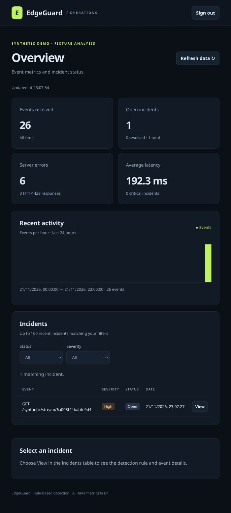
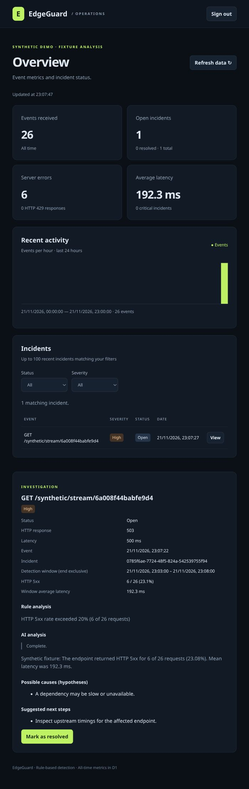
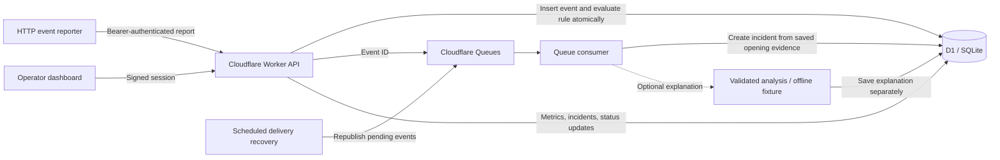

# EdgeGuard

**HTTP event monitoring with deterministic anomaly detection and an operator dashboard.**

EdgeGuard helps developers investigate sustained server-error spikes in their applications. It accepts authenticated HTTP request reports, stores them, detects unhealthy endpoints, and creates incidents with the evidence that triggered them. Operators can inspect that evidence, resolve incidents, and reopen them from the dashboard.

This portfolio MVP demonstrates transactional aggregation, asynchronous processing, idempotent delivery, and incident management. The walkthrough below runs locally; it does not require a deployed service or a Cloudflare account.

## Run the local streaming demo

Prerequisites: Node.js 26, npm, and Python 3 on Linux. Install the locked dependencies once with `npm ci`. After installation, the demo can run without external connectivity:

```bash
npm run demo -- --stream
```

Open the dashboard URL printed in the terminal and sign in with its temporary password. The launcher creates a disposable local D1 database, applies the existing migrations, and starts the Worker with local Queues and an offline analysis fixture. It does not use the remote AI binding in `wrangler.jsonc` or a project `.dev.vars` file.

After a 10-second opening pause, all 26 synthetic observations pass through the real authenticated `POST /api/events` endpoint, approximately 1.2 seconds apart. Eight-second pauses separate the phases. No events or incidents are seeded directly into the streaming database.

| Phase | Reports sent in this phase | Persisted total | HTTP 5xx rate | Expected incidents |
| --- | --- | --- | --- | --- |
| Healthy traffic | 20 × HTTP 200 | 20 | 0/20 = 0% | None |
| Threshold boundary | 5 × HTTP 503 | 25 | 5/25 = 20% | None |
| Threshold crossed | 1 × HTTP 503 | 26 | 6/26 ≈ 23.08% | One **HIGH** incident |

The launcher checks persisted metrics at each boundary and waits for the queue-created incident. It verifies the incident's severity and opening evidence before reporting success. Stable idempotency keys protect retries; a failed request is not counted as successfully ingested.

The dashboard refreshes approximately every three seconds while its tab is visible. The manual **Refresh data** button remains available.

1. Select **View** beside the incident for `GET /synthetic/stream/<run-id>`.
2. Inspect its window, **6/26 HTTP 5xx**, mean latency, rule, and labelled fixture analysis.
3. Choose **Mark as resolved**. Use the **Resolved** status filter to find it.
4. Choose **Reopen incident**, then switch the filter to **Open** or **All**.

The dashboard remains available after verification. Stop with Ctrl+C to terminate the local processes and discard the demo database. Restarting creates a fresh run.

`npm run demo` also remains available: it seeds historical activity and 19 observations per endpoint, then sends the final observation for each of three incidents through HTTP. Use `--stream` to demonstrate every observation traversing ingestion.

## Dashboard screenshots

Captured from a real local `--stream` run: 26 persisted reports, six HTTP 5xx responses, and one high-severity incident. The input is synthetic; the stored counts and opening evidence come from the application.





## Architecture



- **Workers and TypeScript:** validate reports, enforce API roles, publish queue messages, and serve the dashboard.
- **D1:** stores events, incident status, analysis, and immutable opening evidence. An SQL insert trigger updates per-endpoint counters and evaluates the rule in the same transaction as the event insert.
- **Queues:** decouple incident creation and optional analysis from ingestion. Unique constraints prevent duplicate incidents when messages are delivered again. Pending publication has a scheduled recovery path.
- **Dashboard:** plain HTML, CSS, and JavaScript served by the Worker. It reads actual D1 metrics and incidents through authenticated routes; API tokens stay on the server.

The input represents reports about HTTP requests. EdgeGuard does not proxy application traffic, and reported latency is not a measurement of EdgeGuard's own processing time.

## Detection rule

The current rule is `endpoint_5xx_rate_v2`, configured by the single `anomaly_policy` row created in [migration 0006](migrations/0006_endpoint_error_windows.sql).

| Decision | Default condition |
| --- | --- |
| Group observations | Exact HTTP method and reported path |
| Window | Latest stored ingestion minute and four preceding minutes |
| Open an episode | At least **20 requests**, at least **5 HTTP 5xx**, and **strictly more than 20%** HTTP 5xx |
| Opening severity | **Critical** at 50% or above; **high** otherwise |
| Recover and rearm | At least **20 requests** with an HTTP 5xx rate **at or below 10%** |

The window is minute-aligned and uses server-assigned ingestion timestamps. Its current minute is partial. Threshold comparisons use integer cross-multiplication; displayed rounding does not influence decisions. Five failures in 25 requests do not open an incident; the sixth failure in 26 does.

The lower recovery threshold prevents small fluctuations around 20% from repeatedly opening episodes. Sustained failures belong to one active episode per method/path. An idle period alone does not establish recovery: new observations must demonstrate it. Resolving an incident is an operator action and does not rearm the detector. Conversely, measured recovery does not automatically mark an incident resolved.

When an episode opens, SQL saves its counts, percentage, mean latency, window bounds, severity, and policy thresholds as immutable evidence. The queue consumer creates the incident from that snapshot, even if delivery occurs later. Subsequent traffic and status changes do not rewrite it.

Detection is deterministic: the same stored observations and policy produce the same rule decision. AI does not detect anomalies, set severity, resolve incidents, or establish a root cause. When configured remotely, Workers AI through AI Gateway can provide a schema-validated explanation with hypotheses and suggested checks. A failed explanation does not remove the incident.

## Authenticated ingestion

Reporters send JSON to `POST /api/events` with an ingestion Bearer token. This illustrative request uses placeholders, not working credentials:

```http
POST /api/events
Authorization: Bearer <ingestion-token>
Content-Type: application/json
Idempotency-Key: request-0001

{
  "method": "GET",
  "path": "/checkout",
  "status": 503,
  "latencyMs": 500,
  "clientId": "example-service"
}
```

`clientId` is optional. EdgeGuard validates the payload, assigns timestamps, persists the event, and publishes its ID. Successful creation returns `201`; invalid payloads return `400`. The configured ingestion limiter allows 10 requests per 10 seconds per connecting IP and returns `429` when exceeded.

An optional `Idempotency-Key` identifies one observation. Repeating the same key and normalized payload returns the existing event with `200` and `Idempotency-Replayed: true`. Reusing a key with a different payload returns `409`. If publication fails after persistence, retrying with the same key can resume delivery without duplicating the observation.

| Credential | Access |
| --- | --- |
| `INGEST_API_TOKEN` | Submit reports |
| `DASHBOARD_API_TOKEN` | Read events, incidents, and metrics |
| `ADMIN_API_TOKEN` | Read data, resolve/reopen incidents, and retry analysis |
| `DASHBOARD_PASSWORD` | Sign into the single-operator dashboard using a signed session cookie |

The main read endpoints are `/api/events`, `/api/incidents`, `/api/metrics`, and `/api/metrics/timeseries`. Incident listing supports status and severity filters. `PATCH /api/incidents/:id` accepts `{"status":"open"}` or `{"status":"resolved"}`. Missing or invalid API credentials return `401`; a valid token with the wrong role returns `403`.

## Tests

With the locked dependencies installed, run:

```bash
npm run typecheck
npm run typecheck:test
npm test -- --run
npm run test:dashboard-ui
python3 -B -m unittest discover -s test -p 'demo_stream_test.py' -v
```

The Worker tests use `wrangler.test.jsonc`, local D1 migrations, and test-only bindings. The dashboard script tests use a DOM/timer harness; Python tests exercise the stream launcher's pacing, retries, and verification failures. Tests cover detection boundaries and recovery, idempotency, queue processing, authentication, incident actions, polling races, and fixture formatting without changing evidence.

`npm run eval:analysis` runs additional offline analysis contract checks. It tests request construction, validation, and reference cases, not hosted model quality. See [analysis evaluation](docs/analysis-evaluation.md) for details.

## Local demo boundaries

- **Real processing:** HTTP authentication and validation, local D1 persistence, transactional SQL detection, local queue consumption, incident creation, dashboard reads, and status updates.
- **Synthetic input:** the reported endpoints, statuses, and latencies come from a controlled scenario, not a monitored production application.
- **Fixture analysis:** the local explanation is generated deterministically by [demo/worker.ts](demo/worker.ts). Its percentages and latency are formatted for display; stored opening evidence retains full numerical precision. No hosted AI call is made.
- **Local runtime:** Wrangler emulates the configured services. This does not establish remote delivery timing, resilience, deployment configuration, account quotas, or model quality. State is disposable, and this launcher currently targets Linux.
- **Metrics:** dashboard cards are all-time D1 aggregates; the chart uses hourly buckets. A one-minute stream fills one or two hourly buckets, rather than creating a historical traffic chart. Analytics Engine/Analytics SQL telemetry is a separate remote path and is not required by the demo dashboard.
- **Scope:** one operator, static API roles, and one endpoint error-rate rule. There are no user accounts, automatic route-template normalization, percentile-latency alerts, or learned historical baselines. Report route templates where paths contain identifiers.

The deployment-oriented configuration includes a remote AI binding. Use `npm run demo -- --stream` for this offline walkthrough; `npm run dev`, `--live`, and hosted evaluation are separate workflows. This README does not assert a current remote deployment.

## Source guide

- [Worker routes and queue consumer](src/index.ts)
- [Transactional detector and schema](migrations/0006_endpoint_error_windows.sql)
- [Incident persistence](src/incidents.ts) and [D1 metrics](src/metrics.ts)
- [Dashboard session routes](src/dashboard.ts) and [UI](src/dashboard-ui.ts)
- [Analysis validation](src/analysis.ts) and [offline fixture](demo/worker.ts)
- [Disposable demo launcher](demo/run.py)

Licensed under the [MIT License](LICENSE).
